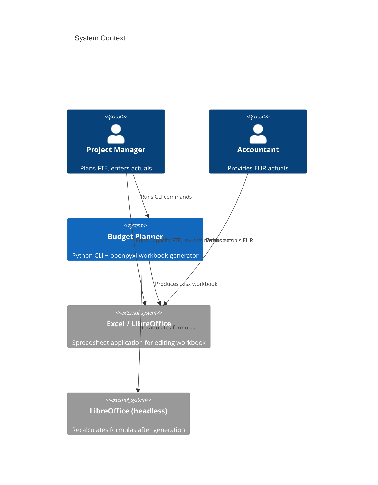
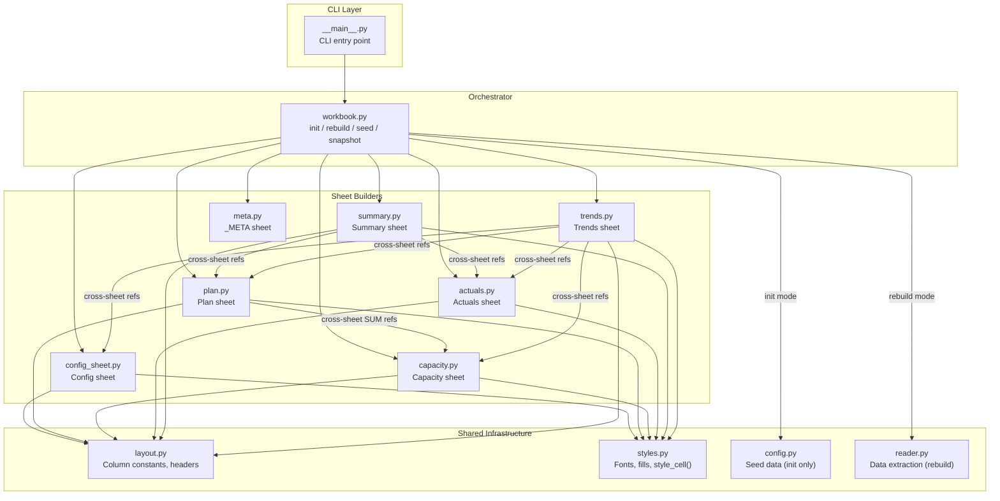
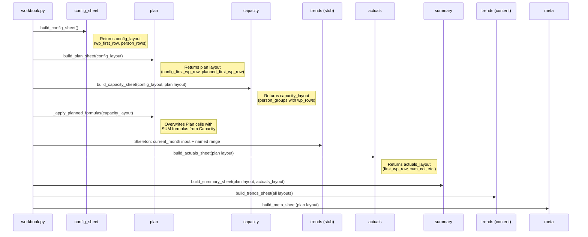

# Architecture Overview

## System Context (C4 Level 1)

The Budget Planner is a CLI tool used by project managers. It produces Excel workbooks that are opened in Excel/LibreOffice. LibreOffice is also used headlessly for formula recalculation.



## Component Architecture (C4 Level 3)



## Build Order

The workbook sheets must be built in a specific order because later builders need row positions from earlier ones:



## Architectural Patterns

### 1. Layout Dict Pattern

Every builder returns a "layout dict" mapping string keys to row/column numbers. Downstream builders receive these dicts to construct cross-sheet formulas. This avoids hardcoded row numbers and makes the system resilient to structural changes.

Example:
```python
# plan.py returns:
{"config_first_wp_row": 8, "planned_first_wp_row": 6, ...}

# capacity.py uses it to build =Config!A8 references
```

### 2. Two-Mode Architecture (Init vs Rebuild)

- **Init**: Reads seed data from `config.py`, builds all sheets from scratch
- **Rebuild**: Uses `reader.py` to extract data from an existing workbook, then rebuilds with preserved user-entered values

The builders themselves are mode-agnostic; the orchestrator (`workbook.py`) selects the data source.

### 3. Single Source of Truth (Config Sheet)

All sheets reference the Config sheet via `=Config!A8` style formulas. This means:
- WP IDs/names display consistently everywhere
- Changing a value on Config propagates automatically
- No data duplication across sheets

### 4. Formula-Only Calculations

All computed values use Excel formulas, never hardcoded Python values. The workbook remains dynamic after generation. Python only sets formula strings.

### 5. Font Color Convention

A financial modeling standard enforced throughout:
- **Blue** (0000FF) = User input cells (editable)
- **Black** (000000) = Formulas (locked, do not overwrite)
- **Green** (008000) = Cross-sheet reference formulas

## Module Breakdown

### workbook.py (Orchestrator)

- **Purpose**: Coordinates sheet building, manages file I/O, validation
- **Key Functions**: `init_workbook()`, `rebuild_workbook()`, `seed_demo_data()`
- **Dependencies**: All builders, config.py (init), reader.py (rebuild)

### layout.py (Constants Hub)

- **Purpose**: Single source of truth for column positions and layout helpers
- **Key Exports**: `MONTH_COL_START`, `val_columns()`, `build_year_month_headers()`, sheet name constants
- **Dependencies**: styles.py (for header styling)

### reader.py (Data Extraction)

- **Purpose**: Read existing workbooks for rebuild round-trips
- **Key Functions**: `read_config_sheet()`, `read_capacity_sheet()`, `read_actuals_values()`
- **Challenge**: Must follow formula reference chains (`=Config!A8` -> resolve from Config)

### styles.py (Styling Primitives)

- **Purpose**: All font, fill, border, alignment constants + `style_cell()` helper
- **Key Feature**: `style_cell()` auto-detects blue font and unlocks cells for protection

### config.py (Seed Data)

- **Purpose**: Default project data for `init` mode only
- **Important**: NOT used during `rebuild`; all data comes from the existing workbook

## Key Design Decisions

1. **Config sheet as primary data source** (not config.py after init)
   - Rationale: Users edit Excel, not Python. Rebuild reads from Excel.
   - Trade-off: Requires robust reader/parser for round-tripping.

2. **Separate Capacity from Plan**
   - Rationale: Plan is per-WP totals; Capacity is per-person-per-WP. Users plan at the person level.
   - Trade-off: Cross-sheet SUM formulas are complex but keep the UX clean.

3. **All validation via Excel formulas and CF**
   - Rationale: Workbook must work standalone without Python.
   - Trade-off: Complex formula construction in Python, harder to debug.
