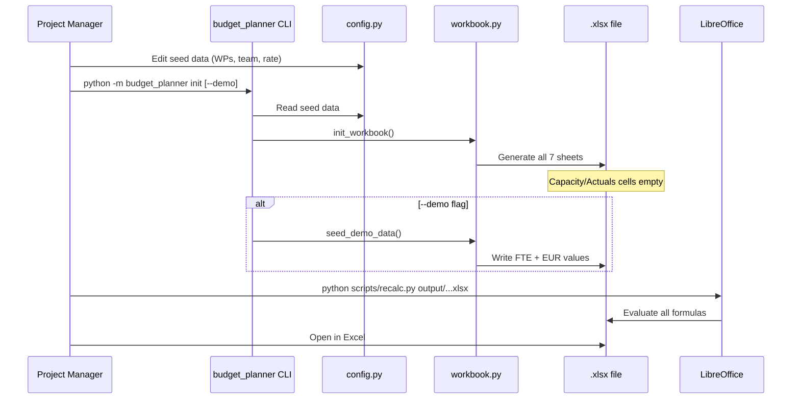
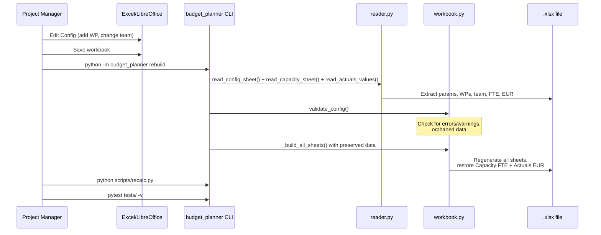
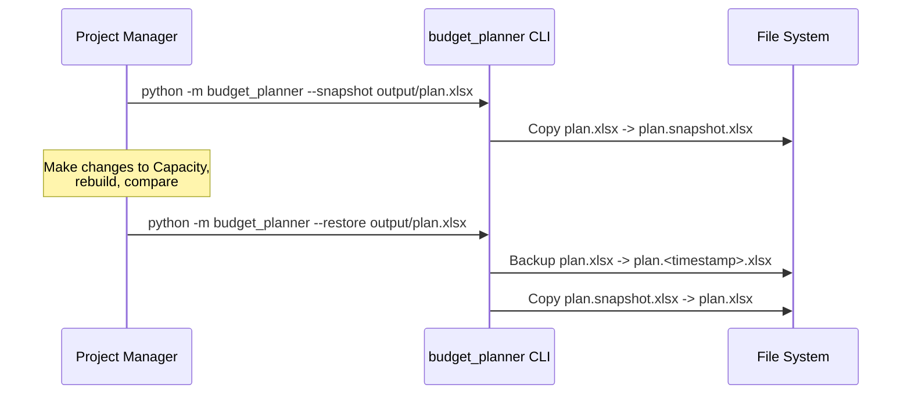
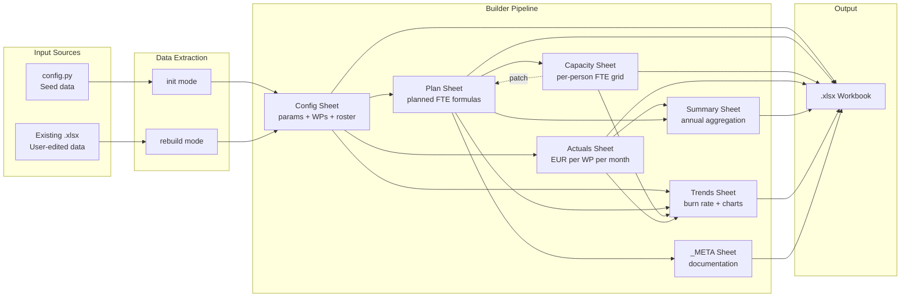
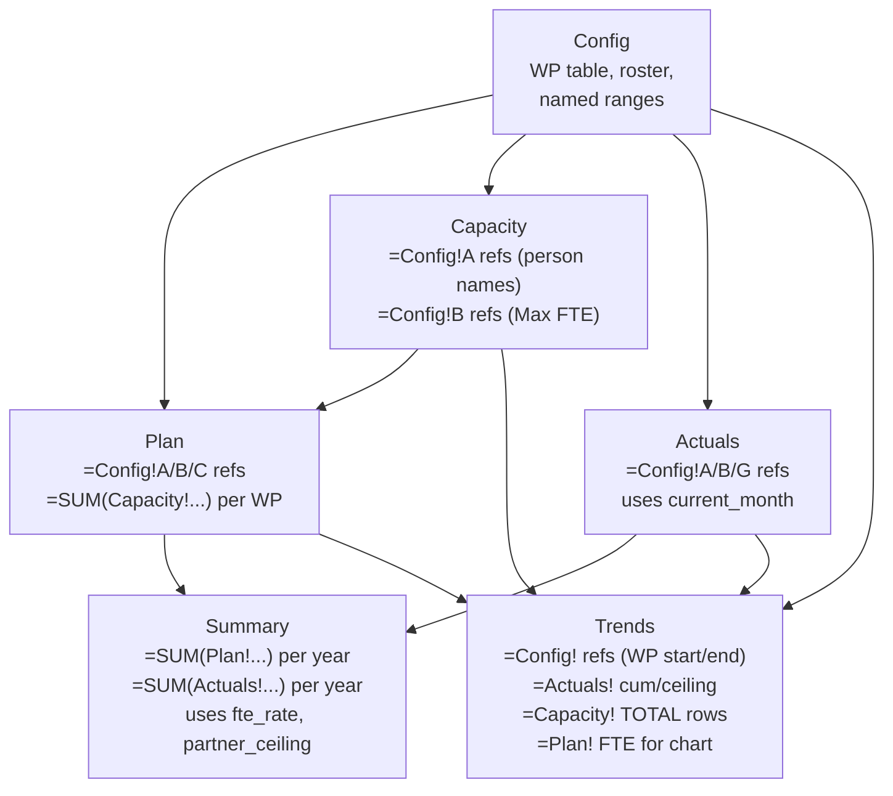

# Workflow Overview

## Core Workflows

### Workflow 1: First-time Setup (init)

### Workflow 2: Day-to-day Planning (edit + rebuild)

### Workflow 3: Scenario Comparison

## Data Flow

## Cross-Sheet Formula References

The workbook uses a directed acyclic graph of cross-sheet references:

## Named Ranges

| Name | Location | Purpose |
|------|----------|---------|
| `project_start` | Config!$B$2 | Project start date |
| `fte_rate` | Config!$B$4 | EUR per person-month |
| `partner_ceiling` | Plan!$I$1 | Total personnel ceiling (EUR) |
| `current_month` | Trends!$B$1 | Last month with completed actuals |

## Rebuild Round-Trip: What Gets Preserved

| Data | Preserved? | Source Sheet |
|------|-----------|--------------|
| Project params (title, start, months, rate) | Yes | Config rows 1-4 |
| Work package definitions | Yes | Config WP table |
| Team roster | Yes | Config roster section |
| External commitments | Yes | Capacity config block |
| Capacity FTE values (per person per WP per month) | Yes | Capacity monthly cells |
| Actuals EUR values (per WP per month) | Yes | Actuals monthly cells |
| current_month setting | Yes | Trends!B1 |
| Formulas, formatting, charts | Regenerated | All sheets |

## Error Handling

### Validation on Rebuild

The rebuild process validates extracted data before regenerating:

**Hard errors** (abort rebuild):
- Invalid project months (<=0 or >120)
- Invalid FTE rate (<=0)
- Empty work packages or team
- Duplicate WP IDs
- External commitment references non-existent team member

**Warnings** (proceed with caution):
- WP start > end
- WP FTE budget <= 0
- Orphaned preserved data (person/WP removed from config)
