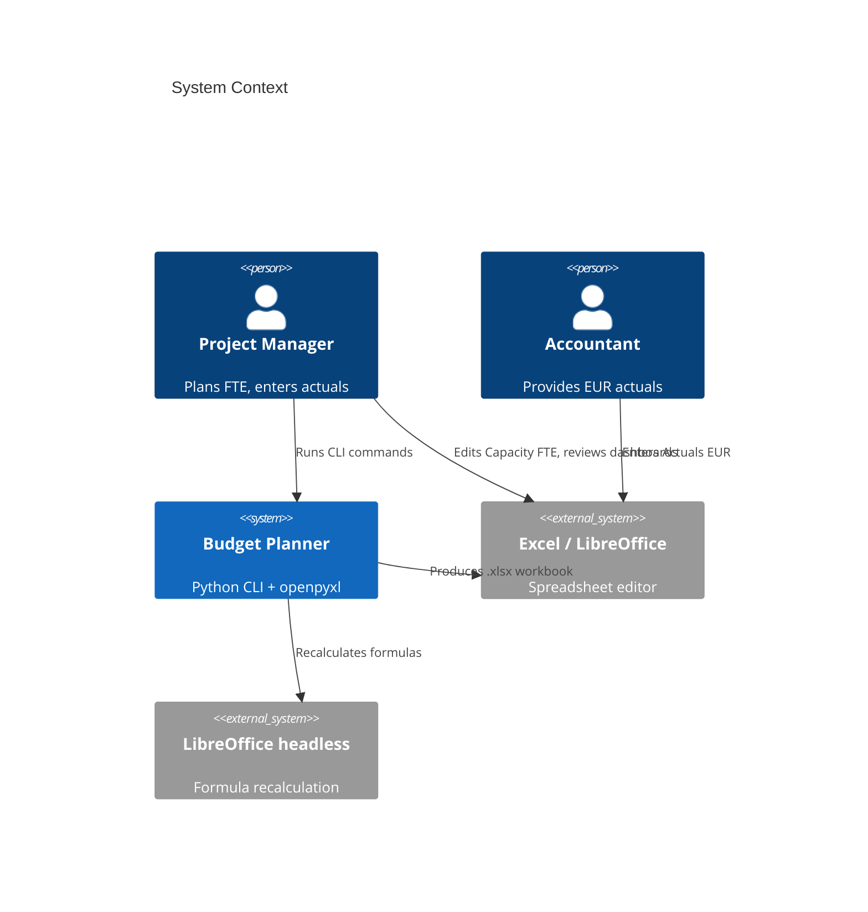
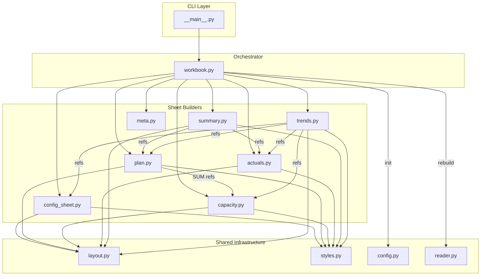
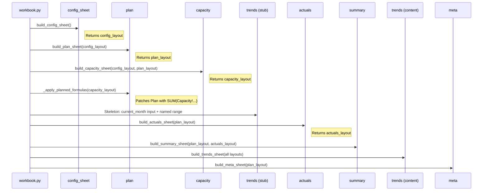
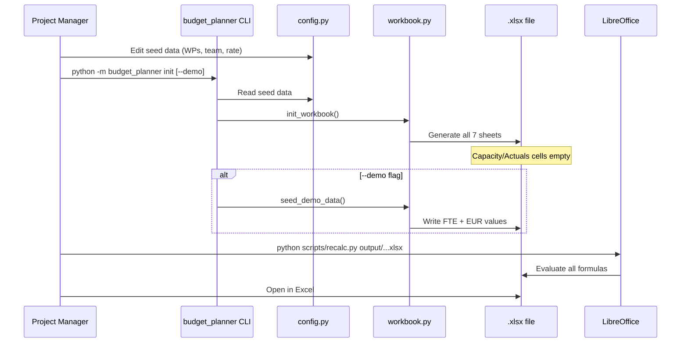
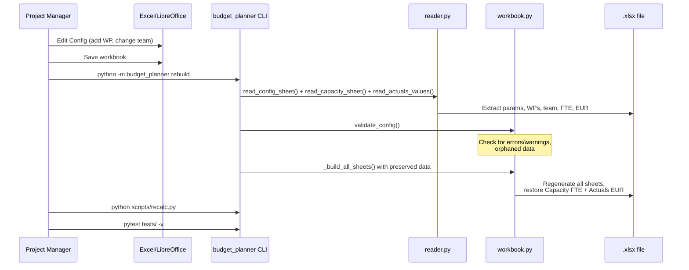
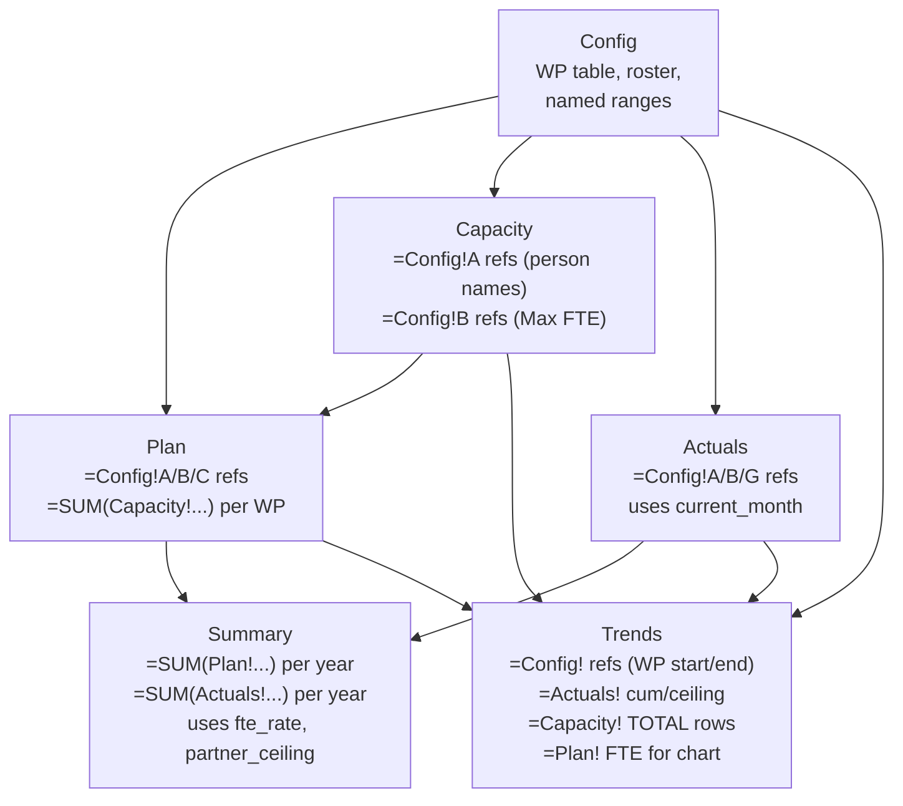

# Architecture Diagrams

## System Context (C4 Level 1)

## Component Architecture (C4 Level 3)

## Build Order

Sheets are built sequentially because later builders need row positions from earlier ones.

## Init Workflow

## Rebuild Workflow

## Cross-Sheet Formula References

Directed acyclic graph of cross-sheet `=SheetName!CellRef` formulas.

## Design Decisions

- **Even FTE spread**: Default allocation divides total WP FTE evenly across active months; users override individual cells in Capacity
- **Single FTE rate**: All EUR amounts are derived from `FTE × monthly rate` (named range `fte_rate`); no per-person salary data
- **Separate Plan / Actuals sheets**: Plan tracks planned FTE (from Capacity SUM); Actuals tracks EUR from accountant. Different units, different sources, never mixed
