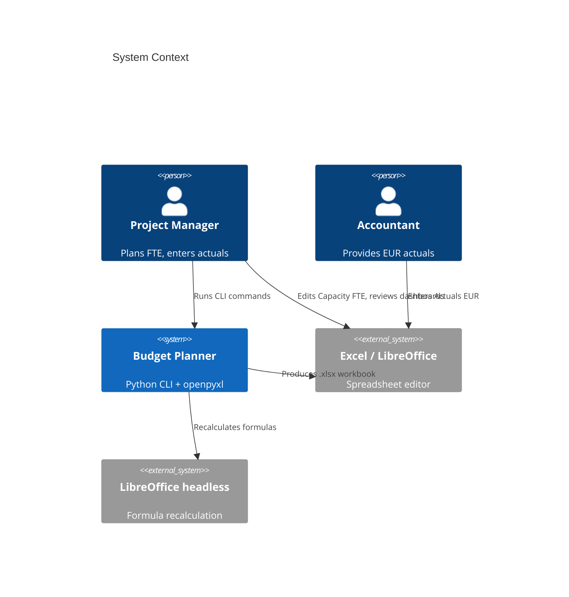
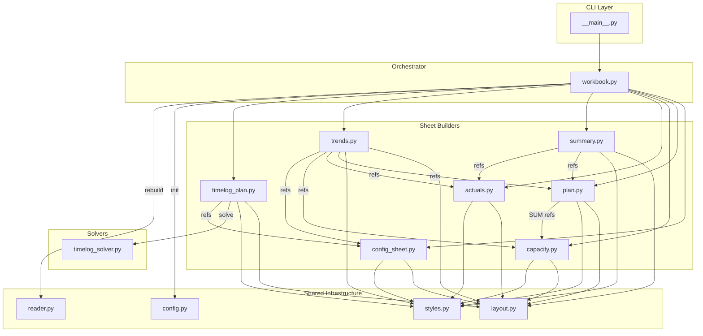
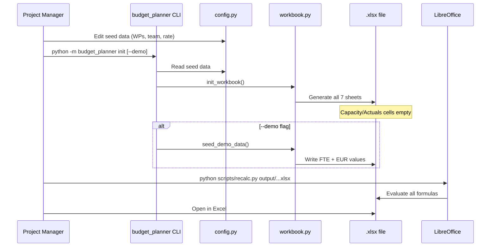
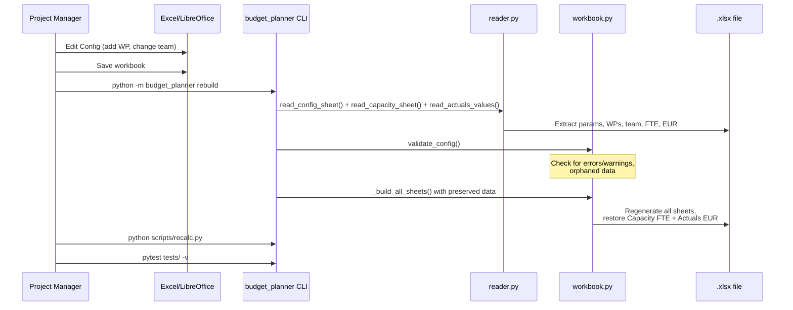
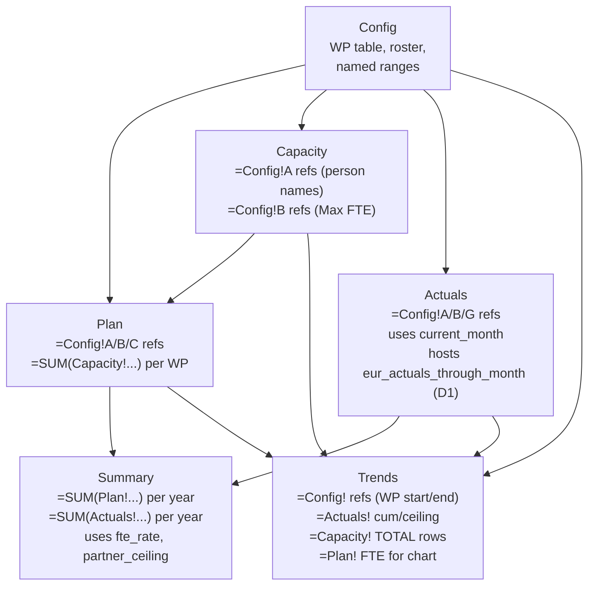

# Architecture Diagrams

## System Context (C4 Level 1)



## Component Architecture (C4 Level 3)



## Build Order

Sheets are built sequentially because later builders need row positions from earlier ones.

```mermaid
sequenceDiagram
  participant WB as workbook.py
  participant CS as config_sheet
  participant PL as plan
  participant CP as capacity
  participant TR as trends (stub)
  participant TLP as timelog_plan
  participant AC as actuals
  participant SM as summary
  participant T2 as trends (content)
  WB->>CS: build_config_sheet()
  Note right of CS: Returns config_layout
  WB->>PL: build_plan_sheet(config_layout)
  Note right of PL: Returns plan_layout
  WB->>CP: build_capacity_sheet(config_layout, plan_layout)
  Note right of CP: Returns capacity_layout
  WB->>PL: _apply_planned_formulas(capacity_layout)
  Note right of PL: Patches Plan with SUM(Capacity!...)
  WB->>TR: Skeleton: current_month input + named range
  WB->>TLP: build_timelog_plan_sheet(config_layout, ...)
  Note right of TLP: Solver writes merged grid on init;<br/>rebuild gated by timelog_resolve_flag
  WB->>AC: build_actuals_sheet(plan_layout)
  Note right of AC: Returns actuals_layout
  WB->>SM: build_summary_sheet(plan_layout, actuals_layout)
  WB->>T2: build_trends_sheet(all layouts)
```

## Init Workflow



## Rebuild Workflow



## Cross-Sheet Formula References

Directed acyclic graph of cross-sheet `=SheetName!CellRef` formulas.



## Sheet Responsibilities

User-facing tab order (set in `workbook.py` after build): **Config → Timelog Plan → Actuals-Hours → Capacity → Plan → Actuals → Plan-Forecast → Trends → Summary**. Positions 1-3 hold the frequently-edited tabs (Config + Timelog Plan + Actuals-Hours) so the user can reach them without scrolling (2026-04-19 v2 redesign). Note the Cross-Sheet Formula References diagram above omits `Actuals-Hours`, `Plan-Forecast`, and `Timelog Plan`; the first two form a secondary data chain documented here in prose, and Timelog Plan is a terminal surface (Config refs in; nothing out).

### Config
Single source of truth for project parameters, WP budget table (incl. each WP's single-range start/end/type), person-WP assignments, external commitments, team roster, reporting periods, and the grade rate table. Hosts the named ranges `project_start` (B2), `fte_rate` (B4), `vacation_month` (B7), `num_vacation_months` (B8), `version_stamp` (B9). The two through-month named ranges (`eur_actuals_through_month`, `hours_actuals_through_month`) now live on the Actuals / Actuals-Hours sheets, not Config — see those sheet sections. **Tab color: Blue (4472C4).** Upstream to every other sheet.

### Capacity
Primary planning surface: per-person monthly FTE allocation across programme WPs and external projects. Includes a to-date block (Plan/Actual/Variance in PM and %) that reads from Actuals-Hours. Feeds Plan via `SUM(Capacity!…)`.

### Plan
Compact 1-row header + Planned-FTE block whose cells are `=SUM(Capacity!…)` per WP × month. Downstream consumers: Summary, Trends.

### Timelog Plan
Prescriptive whole-month 1.0-FTE WP allocation grid — a separate allocation surface from Plan (see `docs/design-invariants.md` § Plan vs Timelog Plan). v2 layout (2026-04-19) + Phase 3–4 totals rows (2026-04-19): single merged editable grid holding literal WP codes, flanked by PER-WP SUMMARY (with per-year EUR columns `Y{yyyy} €` + **Yearly total €** and **Yearly budget €** totals rows beneath the last WP row) and PER-PERSON SUMMARY bands, and a **Monthly total €** row beneath the grid summing non-empty cells × per-person rates. Vacation-month columns are yellow-filled + locked across every person row and the Monthly total € row. Row 2 carries the `timelog_resolve_flag` toggle (cols 9-10) gating whether rebuild re-runs the solver. Consumes `current_month`, `team_priorities`, `roster_lookup`, `num_vacation_months` (Pool formula). **Tab color: Orange (FF8C00).** Terminal surface — no downstream sheet consumes it.

### Actuals
EUR actuals per WP per month (input from accountant) **plus** a parallel forecast-monitoring block that reads Plan-Forecast. Monthly Actual-EUR cells past `eur_actuals_through_month` are greyed via CF — those months are not closed yet. **Hosts the `eur_actuals_through_month` named range at `$D$1` (row-1 through-month control strip: label / optional blue-input override / auto-derived scan / effective cell).** **Tab color: Blue.**

### Actuals-Hours
Per-person monthly hour timelog + sibling forecast-EUR band (`outline_level=1`, collapsible). Sole source of forecast-EUR leaves in the workbook. Consumes named ranges `hours_per_fte_month`, `eu_annual_ceiling_pm`, `roster_lookup`, `eur_actuals_through_month`. **Hosts the `hours_actuals_through_month` named range at `$D$1` (row-1 through-month control strip — same layout as Actuals; sheet name is single-quoted in the DefinedName because of the hyphen).** **Tab color: Red (C00000).** *Not in the Cross-Sheet diagram:* Data flow OUT → Plan-Forecast (SUM per WP × month) → Actuals forecast block → Capacity to-date band → Summary Forecast EUR/year → Trends Cumulative Forecast.

### Plan-Forecast
WP × month forecast-EUR grid aggregating the leaf formulas on Actuals-Hours; mirrors Plan's shape. **Tab color: Green (00B050).** *Not in the Cross-Sheet diagram:* Data flow IN ← Actuals-Hours forecast-EUR leaves; OUT → Actuals forecast monitoring block, Summary Forecast EUR/year, Trends Cumulative Forecast helper row.

### Summary
Calendar-year aggregation. Per WP per year: Plan FTE, Plan EUR, Actual EUR, Forecast EUR, Variance EUR (5 cols/year) plus project total group. Also hosts the budget overview and the Form C reporting-period block. Consumes `fte_rate` and `partner_ceiling`.

### Trends
WP burn rate & exhaustion, cumulative EUR chart (Planned + Actual + Cumulative Forecast + Ceiling), per-person load (planned + actual-side columns). Hosts the `current_month` named range (stub written in build Stage 5 so Actuals formulas resolve). **Tab color: Gold (FFD700).**

## Project Structure

```
budget-planner/
├── README.md                 # This file
├── CLAUDE.md                 # Claude Code project instructions
├── budget_planner/
│   ├── __main__.py           # CLI: init, rebuild subcommands
│   ├── config.py             # WPs, team, external commitments, constants (seed for init)
│   ├── config_sheet.py       # Config sheet builder + reader
│   ├── styles.py             # Font/fill/border constants, column grouping
│   ├── plan.py               # Plan sheet builder
│   ├── team.py               # Team sheet builder
│   ├── capacity.py           # Capacity sheet builder
│   ├── actuals.py            # Actuals sheet builder
│   ├── trends.py             # Trends sheet builder
│   ├── summary.py            # Summary sheet builder
│   ├── reader.py             # Round-trip reader (Config, Team, Capacity, Actuals)
│   └── workbook.py           # Orchestrator: init_workbook() + rebuild_workbook()
├── setup.bat                 # Windows: create venv + install deps
├── init.bat                  # Windows: generate empty workbook
├── demo.bat                  # Windows: generate demo workbook
├── rebuild.bat               # Windows: rebuild from existing workbook
├── tests/                    # pytest suite
├── scripts/
│   ├── recalc.py             # LibreOffice formula recalculator
│   └── office/               # LibreOffice helpers
└── output/
    └── budget_plan.xlsx  # Generated workbook (gitignored)
```

## Design Decisions

- **Even FTE spread**: Default allocation divides total WP FTE evenly across active months; users override individual cells in Capacity
- **Single FTE rate**: All EUR amounts are derived from `FTE × monthly rate` (named range `fte_rate`); no per-person salary data
- **Separate Plan / Actuals sheets**: Plan tracks planned FTE (from Capacity SUM); Actuals tracks EUR from accountant. Different units, different sources, never mixed
