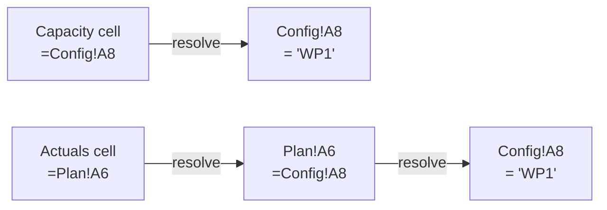
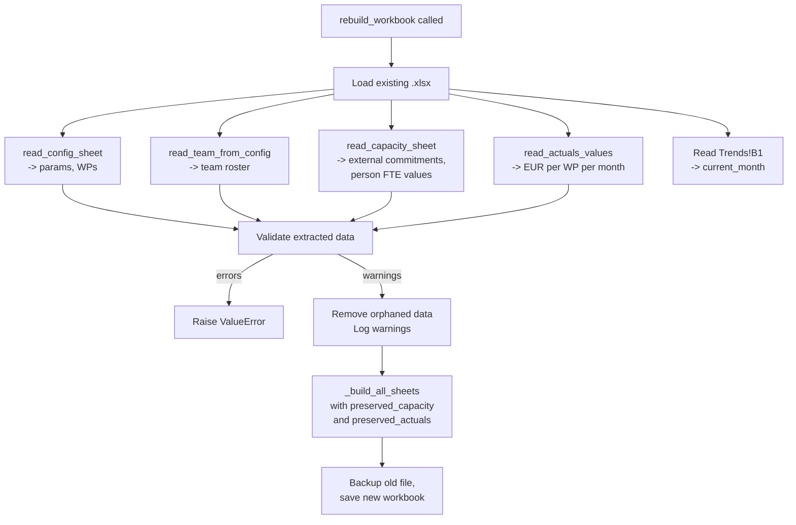

# Deep Dive: Reader and Rebuild

## Overview

The `reader.py` module extracts structured data from an existing workbook so that `rebuild_workbook()` can regenerate all sheets while preserving user-entered values. This is the most fragile part of the codebase because it must reverse-engineer openpyxl-generated formulas.

## Formula Reference Chains

The reader must follow chains of cross-sheet formula references to resolve actual values:



The `_resolve_plan_ref()` function handles this chain resolution, following up to 2 hops (Actuals -> Plan -> Config).

## Data Extraction Functions

### read_config_sheet(ws)

Extracts project parameters (rows 1-4) and work packages (rows 8+):

```
Row 1: Project Title  -> params["title"]
Row 2: Project Start   -> params["start"]
Row 3: Project Months  -> params["months"]
Row 4: FTE Rate        -> params["rate"]
Rows 8+: WP table      -> [{id, name, fte, start, end}, ...]
```

### read_team_from_config(ws)

Finds "TEAM ROSTER" section header, then reads name + max_fte rows until empty.

### read_capacity_sheet(ws, config_wps, project_months)

The most complex reader. Must:
1. Read EXTERNAL COMMITMENTS config block
2. Find person header rows (by bold font + section fill color)
3. For each person, classify rows as WP or external project
4. Read monthly FTE values (skipping formulas and empty cells)

**Person header detection** uses two strategies:
- Primary: scan for bold font + fill color `2F5496`
- Fallback: find TOTAL rows and scan backward

### read_actuals_values(ws, project_months)

Reads EUR values per WP, resolving WP IDs through formula chains.

## Rebuild Flow



## Preserved Data Format

**Capacity FTE:**
```python
preserved_capacity: dict[tuple[str, str], list[float | None]]
# Key: (person_name, wp_id)
# Value: list of monthly FTE values, None for empty/formula cells
# Example: {("Alice", "WP1"): [0.1, 0.1, None, ...]}
```

**Actuals EUR:**
```python
preserved_actuals: dict[str, list[float | None]]
# Key: WP ID string
# Value: list of monthly EUR values
# Example: {"WP1": [7500, 7500, None, ...]}
```

## Orphan Detection

During rebuild, the validator checks for data that references removed entities:

- **Person removed from team**: preserved Capacity entries for that person are dropped
- **WP removed from config**: preserved Capacity and Actuals entries for that WP are dropped
- **External commitment person not in team**: hard error (blocks rebuild)

All orphaned data is logged as warnings and included in the _META sheet's LAST REBUILD LOG.

## Known Fragility Points

1. **Person header detection** relies on specific font/fill styling. If users manually restyle headers, detection fails.
2. **Formula chain resolution** assumes specific formula patterns (`=Config!A8`, `=Plan!A6`). Custom formulas won't be followed.
3. **Row scanning** stops at the first empty cell in column A. Users inserting blank rows mid-table will truncate reads.
