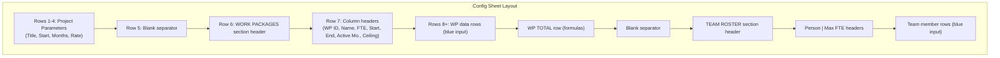
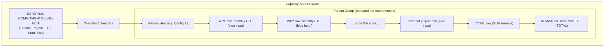

# Deep Dive: Sheet Builders

## Overview

Each Excel sheet is produced by a dedicated builder module that receives data as function parameters and returns a layout dict of row/column positions. Builders are stateless functions that know nothing about init vs rebuild mode.

## Builder Interface Pattern

Every builder follows the same contract:

```python
def build_<sheet>_sheet(ws, wb, ..., *, project_params=None, work_packages=None, ...):
    """
    Args:
        ws: openpyxl Worksheet to populate
        wb: parent Workbook (for named ranges, cross-sheet access)
        ...: upstream layout dicts
        project_params: dict with title, start, months, rate
        work_packages: list of WP dicts

    Returns:
        layout dict with row/column numbers for downstream builders
    """
```

All builders have a lazy-import fallback to `config.py` when params are None, but in practice the orchestrator always passes explicit values.

## Config Sheet (config_sheet.py)



**Key features:**
- Creates `tbl_WorkPackages` Excel Table over header + data range
- Defines named ranges: `project_start` (B2), `fte_rate` (B4)
- Derived columns: Active Months (=End-Start+1), Personnel Ceiling (=FTE*fte_rate)
- CF: yellow if Start > End

**Returns:** `config_layout` with `wp_first_row`, `wp_last_row`, `person_rows` (name->row mapping)

## Plan Sheet (plan.py)

**Structure:**
1. Row 1: Compact header (Title, Start, Rate, Ceiling via cross-refs)
2. Row 3: Section header "PLANNED FTE (PERSON-MONTHS)"
3. Rows 4-5: Calendar year / month headers
4. Rows 6+: WP data rows (formulas, not input)
5. MONTHLY TOTAL row

**Two-phase build:**
1. `build_plan_sheet()` creates the structure with empty FTE cells
2. `_apply_planned_formulas()` fills cells with `=SUM(Capacity!C8,Capacity!C19,...)` after Capacity is built

**Validation columns:** Sum, Budget FTE (from Config), Variance (Budget - Sum)

## Capacity Sheet (capacity.py)

The most complex builder. Creates per-person groups with programme WP rows + external project rows.



**Key features:**
- Every person gets ALL WP rows (even if they don't work on that WP)
- CF on TOTAL: amber > 80% of Max FTE, red > Max FTE
- CF on REMAINING: red if negative
- Preserved values injected into monthly cells during rebuild

**Returns:** `capacity_layout` with `person_groups` dict containing `wp_rows`, `total_row`, `remaining_row` per person

## Actuals Sheet (actuals.py)

**Structure:** Similar to Plan but with EUR input cells and additional validation columns.

**Extra validation columns:**
- Cum. EUR: SUMPRODUCT cumulative up to `current_month`
- % Ceiling: Cum. EUR / Personnel Ceiling
- Breach In: months until ceiling exhausted at current burn rate

**CF rules:**
- Red on negative variance
- % Ceiling: amber > 85%, red > 100%
- Breach In: amber < 12 months, red < 6 months

## Summary Sheet (summary.py)

**Structure:**
- Calendar-year groups, each with 4 sub-columns: Plan FTE, Plan EUR, Actual EUR, Variance EUR
- PROJECT TOTAL group aggregating across all years
- BUDGET OVERVIEW section below totals

**Budget Overview formulas:**
- Personnel Actual (from Actuals total)
- Total Claimable (+25% indirect costs)
- Personnel Ceiling
- Remaining, % Consumed

## Trends Sheet (trends.py)

The dashboard sheet with three sections:

1. **WP Burn Rate & Exhaustion**: per-WP status table with % Time, % Budget, Burn Delta, Status, Exhaustion Month
2. **Person Load**: per-person avg FTE, peak month, status
3. **Cumulative EUR Chart**: LineChart with Planned (blue), Actual (red), Ceiling (grey dashed)

**Hidden helper rows** below person load contain cumulative data series for the chart.

## Dependencies Between Builders

| Builder | Needs from upstream |
|---------|-------------------|
| config_sheet | (none) |
| plan | config_layout.wp_first_row |
| capacity | config_layout.person_rows, plan layout.config_first_wp_row |
| plan (patch) | capacity_layout.person_groups.wp_rows |
| actuals | plan layout.config_first_wp_row |
| summary | plan layout + actuals_layout |
| trends | plan layout + actuals_layout + capacity_layout + config_layout |
| meta | plan layout |
