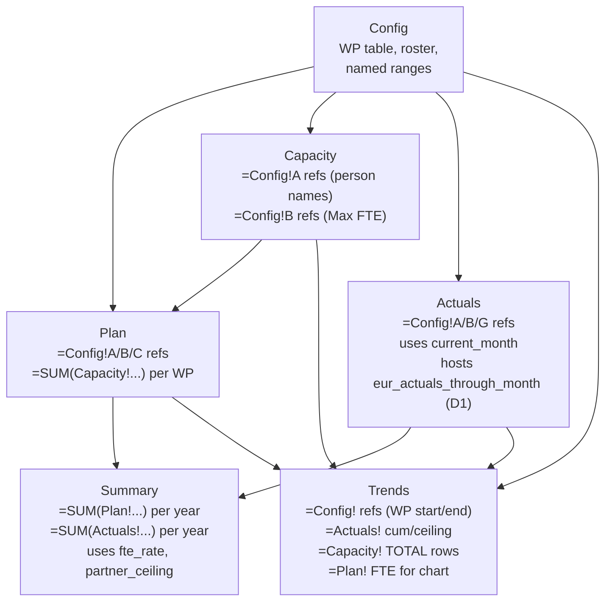

# Spec — cross-sheet invariants, programme rules, engine reference

Single source of truth for facts that must hold across code, tests, and docs. **Entries expire.** When a refactor removes an invariant, delete the entry in the same commit. Strip dated stage tags (`(2026-04-23 as Aiko-port T2)`, `Stage N (TX-TY)`) before merging — git log carries history; this file carries currently-load-bearing specs.

Implementation details (CF rule thresholds, builder interface, per-sheet notes) live in module docstrings adjacent to the code. Operational commands, ops gotchas, dev-workflow situational rules, and the refactor-incident archive live further down in this file (§ Commands, § Ops Quickref, § Dev Workflow, § Refactor Incidents).

---

## Cross-sheet formula graph



The diagram omits `Actuals-Hours` (per-person hour entry; forecast EUR derives per-WP on Actuals from posted-cumulative slope) and `Timelog Plan` (terminal — Config refs in, nothing out).

User-facing tab order: **Config → Timelog Plan → Actuals-Hours → Capacity → Plan → Actuals → Trends → Summary**. Positions 1-3 hold frequently-edited tabs.

---

## Two-cadence actuals (hours vs EUR)

The workbook records actuals on two separate cadences. Any derived view that reads actual data must pick the correct trust boundary — mixing them produces wrong answers that look right.

### Hours cadence

Per-person × per-WP × per-month cells on `Actuals-Hours`.

- **Granularity:** monthly, per person per WP.
- **Entry convention:** **posted-cumulative.** Each filled cell is the running total posted through that month. Blanks are allowed inside the active window (postings arrive irregularly); a single-month cell is NOT the per-month delta. The latest filled cell at-or-before `current_month` IS the currently-posted total; per-month spend is `cum_n − cum_prev` (never stored). Monotonic-non-decreasing within a row is expected but not enforced (correction postings can go backward).
- **Trust boundary:** `hours_actuals_through_month` — named range at `'Actuals-Hours'!$D$1` (black-formula effective cell; sheet name single-quoted because of the hyphen). D1 is `=IF(ISNUMBER(B1),B1,C1)` where B1 is an optional blue-input user override and C1 is an auto-derived scan of the programme-WP hour data (largest 1-based month-index with any numeric value, external/subtotal rows excluded). **Semantic axis: sheet-wide reconciliation cutoff** (max month-index where ANY WP has a value); distinct from per-WP latest posting. Months `1..hours_actuals_through_month` are closed for hours.

### EUR cadence

WP-level totals on the `Actuals` sheet.

- **Granularity:** monthly, per WP (no per-person EUR on `Actuals`).
- **Entry convention:** **posted-cumulative.** Driven by accountant/finance close (2–3 month lag behind hours timelog, often quarterly catch-up postings). Each filled cell is the running EUR posted through that month. Blanks allowed inside the active window. Per-WP `Posted -i` column = latest filled cell at-or-before `current_month`; per-WP slope cell = `posted_value / posted_idx` (avg-burn) drives the per-WP forecast `posted_value + slope × (project_end − posted_idx)`.
- **Trust boundary:** `eur_actuals_through_month` — named range at `Actuals!$D$1` (black-formula effective cell). D1 is `=IF(ISNUMBER(B1),B1,C1)` where B1 is an optional blue-input user override and C1 is an auto-derived scan of the WP EUR data (largest 1-based month-index with any numeric value, TOTAL row excluded). **Semantic axis: sheet-wide reconciliation cutoff** (max across WPs); distinct from per-WP `posted_idx` (this WP's latest filled cell).

### Derived boundary

- "Reconciled through month" = `MIN(eur_actuals_through_month, hours_actuals_through_month)`. Not a named range — Trends holds the single live helper cell (`$B$<recon_section_row+4>`, black formula) and consumers on the same sheet read it via absolute ref; cross-sheet consumers inline the `MIN(...)` expression.

### Design principle (enforce on every new actual-side readout)

Cells hold posted-cumulative totals; per-month deltas are never stored. Every actual-side readout is either (a) a cumulative-through-a-through-month total or (b) a to-date rate (`cumulative / MAX(1, <through_month>)`, inlined). Raw monthly cells never feed a derived metric directly.

### Trends `Cumulative Forecast` line — 2 anchor cells per WP

The Trends chart's per-WP forecast line is driven by exactly two black-formula anchor cells: `(posted_idx, posted_value)` and `(project_end, MAX(0, posted_value + slope × (project_end − posted_idx)))`. Excel/LO interpolates the linear segment. **No per-month helper grid** — a line plotted from N evenly-spaced points equals the line plotted from its 2 endpoints; the grid was solving a non-problem. When `posted_idx = 0` (no postings yet) the cells emit `NA()` so the chart skips the WP entirely.

---

## Plan vs Timelog Plan — two allocation surfaces

The workbook hosts two distinct allocation surfaces, both editable, and they may legitimately diverge:

- **Plan / Capacity** records **actual effort** — fractional monthly FTE per (person, WP) reflecting what people *do*. Driven by Config PERSON-WP ASSIGNMENTS + distribution curves.
- **Timelog Plan** records **timesheet-compliant allocation** — prescriptive whole-month 1.0-FTE WP labels per (person, month). Single merged editable grid holding literal WP codes; no formulas per cell. Initial content comes from `budget_planner/timelog_solver.py`; rebuild is governed by the `timelog_rebuild_from_month` freeze-point.

A person splitting effort 0.6/0.4 across two WPs in a given month may legitimately log 1.0 to one of them that month and 1.0 to the other a different month — the timesheet rule is whole-month, the underlying effort is not. **Do not write cross-sheet formulas that reconcile Plan monthly cells against Timelog Plan monthly cells as if they must agree.** The only shared constraints are the Config inputs both surfaces consume (WP windows, PERSON-WP ASSIGNMENTS windows, Max FTE pool, WP Budget).

### Merged grid = literal values; `timelog_rebuild_from_month` governs re-solve

The merged grid holds literal WP codes (or empty), never formulas — user edits and solver output share one surface. Integer cell Config!$B$9 (named range `timelog_rebuild_from_month`) controls rebuild:

- Let `N = max(1, int(rebuild_from_month))`. Months `< N` are **frozen**: solver does not touch them; preserved WP codes are written back verbatim.
- Months `≥ N` are **solved**: solver re-runs against per-WP `ceiling_eur` (dataclass field; rename to `budget_eur` deferred) and per-Person `pool` narrowed by frozen-span consumption (builder-side subtraction — solver purity preserved). Preserved cells in this span are discarded.
- Endpoints: `N ≤ 1` (or blank) ≡ solve everything; `N > project_months` ≡ preserve everything.
- Overshoot-as-state: if the frozen span over-consumes a WP's `ceiling_eur`, the solver does not raise. The per-WP Buffer +i cell renders the negative residual against the **original** (pre-narrowed) Budget — matches existing out-of-window overshoot semantics.

Readers encountering a pre-v2 workbook (no `timelog_rebuild_from_month` name) default to `1` / solve-all.

### Banned: `MATCH(1, arr, 0)` / `LOOKUP(2, 1/arr, …)` — use `SUMPRODUCT(MIN/MAX(…))`

Formulas that pick the first/last non-empty index via `MATCH(1, (arr<>"")*1, 0)` or `LOOKUP(2, 1/(arr<>""), headers)` depend on CSE array coercion that **openpyxl-written workbooks do not carry** — LibreOffice recalc returns `""` or the wrong extreme silently. Use `SUMPRODUCT(MIN((arr<>"")*COL(...)))` / `SUMPRODUCT(MAX(...))` instead — SUMPRODUCT forces array context natively and survives the openpyxl→LO round-trip.

### Banned: `ISNUMBER(range)` in any array scan — use `(range<>"")`

**Invariant: no emitted cell formula may pass a multi-cell range to `ISNUMBER`.** Excel gives `ISNUMBER(range)` no array context inside a non-CSE formula — it collapses to a scalar, so `SUMPRODUCT(MAX(… * ISNUMBER(range)))` returns `0` and every cell guarded by `IF(idx=0,"",…)` renders blank. The `SUMPRODUCT` wrapper does **not** rescue it (unlike `COLUMN(range)`, which array-evaluates correctly and is not banned). Test filled-ness with `(range<>"")` instead. Scalar uses (`IF(ISNUMBER(B1),B1,C1)`, CF rule predicates) are fine and stay.

LibreOffice array-evaluates `ISNUMBER(range)` correctly, so **`make check` cannot see this defect class** — a recalc test asserting the right index stays green while the workbook is broken in Excel. The guard is therefore static: `tests/test_formula_array_context_guard.py` walks the built workbook and fails on any range argument, with `KNOWN_CSE_GAPS` naming the deliberately-unfixed `Actuals-Hours` sheet. Diagnosis and Excel-computed evidence: `2026-07-27-isnumber-array-context-excel-fix.md` (docs/plans/).

---

## Indirect-view EUR header suffix — `+i` / `-i`

Programme EUR numbers come in two forms: **without-indirect** (`-i`, direct costs only) and **with-indirect** (`+i`, direct × 1.25 with the 25% flat indirect rate folded in). Every EUR-bearing column header on an in-scope sheet carries a `+i`/`-i` suffix with matching `WITH_INDIRECT_HEADER_FILL` (green `#E2EFDA`) or `WITHOUT_INDIRECT_HEADER_FILL` (orange `#FBE5D6`). Non-EUR headers keep `LIGHT_BLUE_FILL`.

**Storage convention — authoritative side is blue-input, mirror is formula.**

- **`Budget +i`** (Config `WP BUDGET` col F, green fill): the grant-agreement partner envelope with indirect folded in. The cell is a structured-reference formula `FTE Budget × Rate × 1.25` (BLACK_FORMULA — Rule 3 carve-out; hand edits reset on rebuild, edit FTE Budget or Rate instead). Authoritative blue-input fields for a WP budget are `FTE Budget` (col C) and `Rate` (col D).
- **`Budget -i`** (Config `WP BUDGET` col E, orange fill): derived `= Budget +i / 1.25`. Preserves the numeric semantic of the retired `Ceiling` column position so deferred consumers reading Config col E keep resolving to a without-indirect number.
- **Forecast-EUR and Actual-EUR rollups** (Actuals) store the accountant-native without-indirect figure as the source; `+i` mirrors wrap each `-i` source in `ROUND(x × 1.25, 0)`.

**In scope:** Config `WP BUDGET`, Actuals, Capacity (EUR cells only — Capacity is FTE-dominant, most headers keep `LIGHT_BLUE_FILL`), Timelog Plan. **Deferred:** Trends, Summary, Plan keep legacy "Ceiling" wording until the follow-on overhaul; do not rewrite their EUR terminology drive-by.

**Terminology.** Use "Budget" everywhere, not "Ceiling". When quoting the grant agreement itself ("EUR ceiling per partner"), preserve the source wording as a quotation — do not rewrite regulatory text.

**Round-trip check:** for every WP, `wp_budget_with_indirect[i] / 1.25 == Budget -i[i]` within float-noise.

---

## Font color convention

Blue = input, Black = formula, Green = cross-sheet ref. CLAUDE.md Critical Rule 3 enforces this.

`style_cell()` auto-unlocks cells with blue font (`Protection(locked=False)`) so blue inputs stay editable when sheet protection is re-enabled.

---

## Named-range contract

| Named range | Written by | Read by |
|---|---|---|
| `project_start` | `config_sheet.py` (Config!$B$2) | nearly every builder (date math, headers) |
| `fte_rate` | `config_sheet.py` (Config!$B$4) | `plan.py` leaves (currently via direct Config ref; pending consolidation) |
| `hours_actuals_through_month` | `actuals_hours.py` (`'Actuals-Hours'!$D$1`, black-formula effective `=IF(ISNUMBER(B1),B1,C1)`) | `capacity.py`, `actuals_hours.py` (greying), `summary.py` (partial-year shading), `trends.py` (reconciliation, NA-clipping). Inlined as `MAX(1,hours_actuals_through_month)` at every prior `months_elapsed_hours` callsite. |
| `eur_actuals_through_month` | `actuals.py` (`Actuals!$D$1`, black-formula effective `=IF(ISNUMBER(B1),B1,C1)`) | `actuals.py` (Breach-In rate-anchor, Posted through: header), `summary.py`, `trends.py`. Inlined as `MAX(1,eur_actuals_through_month)` at every prior `months_elapsed_eur` callsite. |
| `roster_lookup` | `config_sheet.py` (Team Roster cols A-D: name, Max FTE, grade, rate EUR/PM; Priority col E intentionally excluded so existing VLOOKUP indices stay stable) | `config_sheet.py` (Assignments Balance VLOOKUP col 2), `timelog_plan.py` (per-person rate helper VLOOKUP col 4) |
| `team_priorities` | `config_sheet.py` (Team Roster Priority col E, blue input, default 2) | `timelog_plan.py` solver fill order — priority flows in via `reader.read_team_from_config` (header scan, not name resolution). Named range reserved for future Excel-formula consumers. |
| `current_month` | `workbook.py` Stage 5 Trends stub (Trends!$B$1, **black formula** — `=MAX(1,MIN(Config!B3, ...))`; user may overwrite with a static number). Stub written before Actuals builder runs. | `actuals.py` (Posted -i / Breach-In cutoff), `timelog_plan.py` (per-WP `Burn rate needed`) |
| `timelog_rebuild_from_month` | `config_sheet.py` (Config!$B$9, blue-input integer, default `1`, `min=1 / max=999` data validation) | `reader.read_timelog_plan` returns it as `rebuild_from_month: int`; `timelog_plan.py` builder partitions `preserved_grid` and narrows solver-input |
| `vacation_month` | `config_sheet.py` (Config!$B$7, blue input string, default `"Jul"`) | `reader.read_config_sheet` → orchestrator + `timelog_plan.py` solver. Fallback to `"Jul"` when missing. |
| `num_vacation_months` | `config_sheet.py` (Config!$B$8, BLACK_FORMULA builder-written literal — Rule 3 carve-out) | `timelog_plan.py` PER-PERSON SUMMARY Pool formula: `=ROUND(max_fte × (project_months − num_vacation_months), 0)` |
| `wp_budget_with_indirect` | `config_sheet.py` (`Config!$F${wp_first_row}:$F${wp_last_row}` — the `Budget +i` column) | `actuals.py` (`=INDEX(wp_budget_with_indirect, i+1)` for per-WP `Budget +i` rollups) |
| `version_stamp` | `config_sheet.py` (Config!$B$10) | (informational) |

**Reader/builder round-trip rule**: readers use named ranges (not coordinates); tolerate internal blanks; rebuild must preserve user-authored values on blue input cells.

Config-hosted named ranges parsed by `tests/test_config_sheet.py::test_config_named_range_targets_match_spec_doc` (keep this table shape):

| Named range | Cell | Kind |
|---|---|---|
| `project_start` | Config!$B$2 | Named range |
| `fte_rate` | Config!$B$4 | Named range |
| `timelog_rebuild_from_month` | Config!$B$9 | Named range |
| `version_stamp` | Config!$B$10 | Named range |

---

## Vacation cells — locked and empty

Every Timelog Plan grid cell whose 1-indexed project month matches the calendar `vacation_month` must carry `VACATION_FILL` (pale yellow `#FFF2CC`), `Protection(locked=True)`, and an empty string value across every person row (NOT BLUE_INPUT — cell is not user-editable). The solver must never place a WP code there; on rebuild the builder drops vacation-month entries from `frozen_placements` before overlay, so a preserved WP code in a vacation cell is discarded regardless of where vacation falls relative to `timelog_rebuild_from_month`. No CF rule targets vacation cells; the direct yellow fill is authoritative. Violating any leg breaks the programme auditor story (vacation time is non-allowable) or breaks the solver's `(grid<>"") × rate` SUMPRODUCT inputs.

Other Timelog Plan implementation details (Pool formula, Monthly total € row, Yearly rows, build-time proportions) live in `timelog_plan.py` module docstring and `_write_*` helpers.

---

## WP schedule — single active range

Every WP has exactly one `(start, end)` pair (cols H/I of WP BUDGET). The reader hard-fails on multi-row per WP or legacy two-section Config layout with a `ValueError` carrying a migration recipe. Multi-segment schedules are rejected at rebuild.

---

## Row-order contracts (cross-sheet)

Cross-sheet formulas (Plan's `=SUM(Capacity!...)`, Trends person-load refs, Summary aggregations) index by row position, so row order is a contract not an accident.

- **Capacity person order matches Config TEAM ROSTER order.** Adding a roster row shifts every downstream Capacity person group.
- **Plan WP row order matches Config WP BUDGET order.** Same for Actuals, Summary.
- **Capacity per-person WP rows are ordered by Config PERSON-WP ASSIGNMENTS** for that person (intersection filter — not all WPs), further reduced to assignments with non-zero `total_fte`. Zero-FTE assignments stay in the Config auditor table but their per-person grid row is suppressed on Capacity AND Actuals-Hours so the row-order mirror invariant holds. Empty-window intersection rows (non-zero `total_fte` but the assignment window has no overlap with the WP active range) still render as all-grey rows — out of scope for the zero-FTE filter.
- **Actuals-Hours person + WP row order mirrors Capacity at the WP rows.**

### Per-person Capacity geometry

Per-person sequence: header → WP rows (assigned only) → external rows → TOTAL. REMAINING < 0 folds onto TOTAL > Max FTE (same red). The Actuals-Hours EU TOTAL row + per-year EU ceiling CF + the `include_eu_total` opt-in on `person_section.plan_person_layout` are deleted in the posted-cumulative redesign (2026-05-09 design); compliance is a manual check thereafter.

---

## Inactive-month rule

On every sheet with monthly data (Capacity, Plan, Actuals, Actuals-Hours), months outside the intersection of the assignment window `[Start, End]` and the WP's single-range active months are **greyed and empty**. Distribution curves must never leak FTE into out-of-range months. Auditors reject PM logged outside a WP's active range.

---

## Config `Budget +i` (col F) is a derived black-formula

`Config!F{wp_first_row}:F{wp_last_row}` holds a structured-reference formula into `tbl_WorkPackages` resolving to `FTE Budget × Rate (€/PM) -i × 1.25`.

- **Rule 3 carve-out**: the cell uses `BLACK_FORMULA` font even though Budget +i is semantically the grant-agreement figure.
- **Reader round-trip**: `reader.py::read_config_sheet` loads Config under `data_only=False`, so the cell value is the formula string; `_safe_float` falls back to the same `FTE × Rate × 1.25` product, preserving `budget_plus_i` numerically.

`_write_wp_summary_row` (Timelog Plan PER-WP SUMMARY col B) xrefs `Config!$F{cfg_wp_row}` directly. `_write_yearly_rows` cross-checks: `yearly_total_row` col C = `SUM(C{first}:C{last})` is `-i`; `yearly_budget_row` col C = `SUM(B{first}:B{last})` is `+i`. Drift-detection between `yearly_total_row` col C and per-year cells on the same row requires a ×1.25 scale (col C `-i`, per-year cells `+i` via ×1.25-at-leaf). See `tests/test_timelog_plan.py::test_yearly_total_col_c_crosscheck`.

---

## Programme domain rules — what gates code

The full programme lifecycle (proposal → grant agreement → execution → reporting → close-out) is at `docs/human/grant-lifecycle.md` (`.claudeignore`'d, human-only reference). Below: only the rules that gate validation, formulas, or invariants.

### Cost model

```
PM[i] × monthly_rate[i] = personnel EUR per partner
  + travel + equipment + subcontracting + other_direct
  = total direct costs
  × 1.25 (25% flat indirect rate, automatic, applied to direct costs EXCLUDING subcontracting)
  = total eligible costs
  × funding_rate  (this project: up to 70%)
  = EU grant per partner
```

### Hard constraints

- **Partner ceiling**: Sum of all costs per partner ≤ grant agreement EUR ceiling for that partner.
- **No double funding**: A person's total declared time across all EU grants ≤ 12 PM/year. Encoded as `eu_annual_ceiling_pm` (215-day regulatory cap on the PM-per-FTE-year basis).
- **WP active range**: Every WP has a single contiguous `[Start, End]` — no multi-segment schedules. Auditors reject PM logged outside this range.
- **Vacation months**: Auditors reject PM logged during vacation. The workbook encodes a single uniform vacation month via `vacation_month` (default `"Jul"`); `num_vacation_months` counts calendar-vacation months inside the project span. Heterogeneous per-(person, year) vacation is deferred — a future Config `Vacation Schedule` table can layer on additively.
- **Subcontracting**: Cannot cover core project tasks. Excluded from the 25% indirect base.
- **Audit threshold**: Partners claiming > €430k total need a Certificate on Financial Statements (CFS).

### Reallocation (without grant amendment)

- **Between WPs for same partner**: PMs can shift freely as long as partner ceiling holds.
- **Between cost categories within a partner**: generally flexible; large structural shifts may need project officer approval.
- **Between partners**: requires formal grant agreement amendment. **Hard boundary.**
- **Increasing total project budget**: requires amendment, rarely approved.

### WP distribution-curve types

Each WP has a single contiguous active range and a single `Type` from `{flat, front-loaded, bell, back-loaded}`. Type drives the per-month curve shape `capacity.py::distribute` applies to each assignment's `Total FTE` scalar.

| Type | When to use |
|------|-------------|
| `flat` | Steady-state work — management, ongoing analysis. |
| `front-loaded` | Fast-start work — early design, research. Tail is minor. |
| `bell` | Ramps, peaks mid-range, tapers — iterative design. |
| `back-loaded` | Deadline-driven — integration, assembly, demo prep. |

### Key insight

**EUR per partner is the ceiling. PMs are the lever.** During execution, free to reallocate PMs across work packages within the partner envelope. Hard triggers for grant amendment: moving money between partners or changing total project scope.

---

## Reader and Rebuild contract

`reader.py` extracts structured data from an existing workbook so `rebuild_workbook()` can regenerate all sheets while preserving user-entered values. Most fragile module.

**Config trust boundary.** Init seeds = `config.py` public defaults ← optional overlay file applied at import (`overlay_dir_from_env()`; dir from `BUDGET_PLANNER_OVERLAY_DIR`, else the same key in the dotfiles `shared-settings/` layer, else none; `""` disables, tests pin it off). Rebuild never consults either: it reads the workbook's own Config sheet.

### Formula chain resolution

Reader follows cross-sheet refs to resolve actual values: `Actuals cell =Plan!A6 → Plan!A6 =Config!A8 → Config!A8 = "WP1"`. `_resolve_plan_ref()` follows up to 2 hops.

### Extraction functions

| Function | Extracts | Key technique |
|----------|----------|---------------|
| `read_config_sheet(ws)` | Project params (blue-input scalars + Vacation Month; derived `num_vacation_months` + `version_stamp` via named ranges) and WP table. Through-month values read from Actuals / Actuals-Hours, not Config. | Direct cell reads + named-range map |
| `read_actuals_override(ws)` | Optional integer blue-input override on the row-1 through-month strip; returns `None` when blank/non-numeric so the effective cell falls through to auto-derived scan | Typed cell read |
| `read_team_from_config(ws)` | Team roster (name + max_fte) | Scans from "TEAM ROSTER" header |
| `read_capacity_sheet(ws, ...)` | External commitments, per-person monthly FTE | Person header detection by bold + fill `2F5496` |
| `read_actuals_values(ws, ...)` | EUR per WP per month | Formula chain resolution |
| `read_timelog_plan(wb, months)` | Merged-grid literal WP codes per (person, month) + `rebuild_from_month` integer from Config!$B$9 (defaults `1` / solve-all when missing). Returns `{"grid": dict, "rebuild_from_month": int}`. | Col-A person-row scan + `TIMELOG_MONTH_COL_START` offset; named-range lookup for freeze-point |

### What rebuild preserves

All sheets are regenerated from scratch. Only these user-entered values survive:

| Data | Source in old workbook |
|------|----------------------|
| Project params, WP definitions, team roster, grade rates, reporting periods | Config sheet sections |
| Person-WP assignments, external commitments | Config PERSON-WP ASSIGNMENTS (B2) + EXTERNAL COMMITMENTS (B3) sections |
| Monthly EUR values per WP | Actuals data cells |
| Hour timelog per person × WP × month | Actuals-Hours data cells |
| Timelog Plan merged-grid cells (WP codes) | Timelog Plan grid; preserved verbatim for months `< timelog_rebuild_from_month`; months `≥ N` are re-solved (preserved cells discarded). Default `N = 1` re-solves everything. |

Everything else (formulas, styling, CF, charts, Plan/Summary/Trends) is overwritten.

### Preserved data structures

```python
preserved_capacity: dict[tuple[str, str], list[float | None]]  # (person, wp_id) → [monthly]
preserved_actuals: dict[str, list[float | None]]               # wp_id → [monthly EUR]
```

### Orphan detection

- Person removed from team: Capacity entries dropped (warning).
- WP removed from config: Capacity + Actuals entries dropped (warning).
- External commitment references missing team member: hard error.

All orphaned data printed to stderr at rebuild. Hard errors abort; warnings do not.

### Row-span resolution (named-range-primary)

Reader functions for Config tables (`read_team_from_config`, `read_assignments_from_config`, `read_externals_from_config`) are **named-range primary**: they resolve `roster_ftes` / `assign_persons` / `ext_persons` via `wb.defined_names` as the authoritative row span, then iterate within and tolerate internal blanks. Excel auto-extends these named ranges when the user inserts rows inside them, so reader bounds stay in sync with live data after hand-edits. Only when a named range is missing (legacy workbooks) does the reader fall back to sentinel-based scanning that stops at the first blank. See `_iter_named_range_rows` in `reader.py` and shape-drift tests in `tests/test_rebuild_shape_drift.py` / `tests/test_rebuild_shapes.py`.

### Reader column-shift invariant

Inserting a new column into a structured section (WP BUDGET, Team Roster, etc.) requires every position-based reader to branch on layout detection AND shift `start_col/end_col/type_col`-style indices — not just the renamed cell. Readers index by numeric column, not header association: shifting `COL_WP_START` 8→9 invalidates every pre-shift workbook's Start read, surfacing as `int('flat')` when the shift misaligns End and Type.

Detect legacy vs post-shift via header-string match at the inserted column's position (NOT `version_stamp` — that's a git-describe literal, not a schema version). Seed a test fixture that writes cells at the pre-shift physical positions and assert end-to-end rebuild parse to lock the contract.

### Known fragility

1. **Person header detection** relies on specific font/fill styling. Manual restyling breaks detection.
2. **Formula chain resolution** assumes patterns like `=Config!A8`. Custom formulas are not followed.
3. **Sentinel-scan sections** (WP BUDGET, RATE BY GRADE, reporting periods) still stop at the first blank in column A. Use filled rows when hand-editing these, or add named ranges to extend the same treatment as roster/assignments/externals.

---

## Solvers

Pure algorithmic modules — no openpyxl, no workbook I/O. Called by a builder, return plain-Python data structures the builder writes into cells. Strictly deterministic so tests can pin behaviour.

### timelog_solver (`budget_planner/timelog_solver.py`)

Two-pass greedy allocator driving the Timelog Plan merged grid on init (and on rebuild for months `≥ timelog_rebuild_from_month`, against ceilings + pools narrowed by frozen pre-N consumption).

- `greedy_pass(persons, wps, person_wp_windows, project_months)` — fills WPs in earliest-close order; within a WP, priority-1 persons before priority-2 before priority-3; continue-a-run preferred over starting a new run. Two-sided buffer policy: upper cap `MAX_BUFFER_PCT` = +12% (skip placements that would push past `ceiling × 1.12`); lower cap `MIN_BUFFER_PCT` = -11% (when skipping would leave the WP below `ceiling × 0.89`, place anyway — overshoot beyond +12% wins over undershoot deeper than -11%). WPs with no remaining candidates can still finish below the lower cap; that is a capacity shortfall, not a policy choice.
- `switch_reduction_pass(assigned, ...)` — adjacent-pair local search: swaps `(p1, m, m+1) ↔ (p2, m, m+1)` whenever the swap is legal and strictly reduces the total switch count. **Known shape limitation:** only pair-wise adjacent swaps. Rearrangements requiring a 3+ month block swap or a same-month-window 3-person rotation are not found. Trades optimality for determinism + bounded runtime.
- `solve(...)` — composed entry point: `greedy_pass` then `switch_reduction_pass`. Deterministic → reproducible tests in `tests/test_timelog_solver.py`.
- `classify_wp_stop_reasons(...)` — pure post-pass classifier surfaced as col J "Stop reason" on PER-WP SUMMARY (year cols → K..). Closed enum, priority-ordered → see `budget_planner/timelog_solver.py` docstring for the 8 strings + trigger conditions.

If a future builder needs algorithmic assignment beyond the current curve presets, it belongs as a sibling solver module, not inside the builder.

---

## Tab colors (semantic role markers)

Don't change without updating this mapping.

| Sheet | Tab color | Why |
|-------|-----------|-----|
| Config | Blue (4472C4) | Single source of truth for all parameters |
| Capacity | Purple | Primary planning surface (derived from Config assignments) |
| Timelog Plan | Orange (FF8C00) | Prescriptive 1.0-FTE WP allocation — distinct from Plan/Capacity |
| Actuals | Blue (0000FF) | EUR input from accountant |
| Actuals-Hours | Red (C00000) | Hours input — primary hours surface |
| Summary | Green (008000) | Read-only aggregation |
| Trends | Gold (FFD700) | PM dashboard |

`apply_year_groups()` creates collapsible column groups per calendar year. The group containing `current_month` is expanded; others collapse.

---

## Commands

### Dev environment setup

```bash
uv venv && uv pip install -e ".[dev]"
```

### Generate a workbook

```bash
# Empty workbook from config.py seeds
python -m budget_planner init

# Demo workbook with Capacity + Actuals data
python -m budget_planner init --demo

# Rebuild from existing workbook (preserves assignments + Actuals EUR)
python -m budget_planner rebuild

# Copy to output/budget_plan.<YYYYmmdd_HHMMSS>.xlsx, original left in place
python -m budget_planner archive
```

After any generation, run recalc + tests — see CLAUDE.md Critical Rule 2.

### Scenario comparison

```bash
python -m budget_planner --snapshot output/budget_plan.xlsx
python -m budget_planner --restore output/budget_plan.xlsx
```

Use `--snapshot` to save current state, make changes, compare. Use `--restore` to revert.

### Recalc + test

```bash
python scripts/recalc.py output/budget_plan.xlsx
pytest tests/ -v
```

### Common tasks

Most data tasks (WPs, team roster, actuals, vacation month) edit the Config or Actuals sheet in Excel, then run `python -m budget_planner rebuild` + pytest. Verify via pytest — don't MCP-scan as a routine step.

Non-obvious cases:
- **Add Summary column/metric**: edit `budget_planner/summary.py`; new cross-sheet invariant → record in this spec; layout shift → update `budget_planner/layout.py` + spec.
- **Per-person vacation exception**: not supported. Vacation is uniform via the `vacation_month` scalar. Roadmap option: add a Config `Vacation Schedule` table layered additively on top of the scalar.
- **Import actuals from timesheet**: not applicable — Actuals tracks EUR from accountant, not FTE from timesheets.

---

## Ops Quickref

Short pointers for agents. Full human runbooks live under `docs/human/` and are `.claudeignore`'d — load only when explicitly asked.

### LibreOffice is a hard dependency

`soffice` is the formula recalc engine. Without it, ~40% of the test suite skips silently. Install with `sudo apt-get install -y libreoffice-calc`.

### Common failure modes

| Symptom | Fix |
|---------|-----|
| Tests report "skipped"; `demo_recalc` fixture unavailable | Install LibreOffice. |
| `recalc.py` succeeds but `data_only=True` cells are `None` | Delete `~/.config/libreoffice/4/user/basic/Standard/`, retry. |
| `recalc.py` exits 124 (timeout) | Kill stale soffice + remove lock: `pkill -f soffice && rm -f ~/.config/libreoffice/.~lock.*`, retry. |
| LO crashes with `--headless` in a container | `unset DISPLAY`, retry. |

### Debugging against the user's real workbook

Never open the user's confidential `output/*.xlsx` file. Generate a shape-preserving synthetic via `python -m scripts.make_reproducer <path>` — outputs `tmp/synthetic.xlsx` + `tmp/fp.json` with deterministic fake values (`Person_01`, `WP_A`). The `tests/test_privacy_canary.py` canary guards the pipeline against cell-value leaks. Ask the user for the synthetic path; do not ask for the real file.

Full runbooks (pre-flight script, macro-dir init, per-failure XML probes, reproducer workflow detail) live in `docs/human/` — ignored by default.

---

## Dev Workflow — Review, Planning, Worktrees, MCP

Situational workflows loaded on demand. For always-on rules (build/test, linting, formatting, testing, invariants) see `.claude/rules/dev-workflow.md`.

### Code Review

When a plan claims a module is "unchanged", grep its imports to verify no coupling to changed modules.
When inserting/removing a column on any sheet, grep ALL formula references (`Config!{letter}`, `Plan!{letter}`, etc.) across every builder AND test file. Column shifts cascade silently — a test asserting the old column letter will mask the bug.
When inserting/removing a Config param row, grep ALL test files for hardcoded row numbers (e.g. `cell(4, 2)`, `wp_first_row = 8`, merge span tuples). Row shifts cascade into tests the plan doesn't list.
When changing error message format in reader/builders, grep test files for the old message pattern (`pytest.raises(match=` strings). Semantic changes in validation produce silent test failures.
When changing a Config cell from input (blue) to formula (black), grep all consumers of the corresponding reader field (e.g. `params["rate"]`) — validators, builders, demo seeder, and tests may assume a numeric type.
Backward-compat fallbacks must trigger on *marker presence* (section header, version field, sheet name), not on an empty reader result. Empty-result triggers conflate "user cleared" with "marker missing" — on rebuild, the old source silently restores state the user intentionally deleted.
When splitting a doc or rule file, grep the source for in-file anchors (`§ X`, `below`, `above`, `see § `) before and after — split moves break them silently. Also report the split to the user (what moved where, which trigger reloads it), not just "task complete".
When resuming a plan from memory, verify actual file state before acting — memory snapshots go stale between sessions and tasks marked "pending" may already be done.

### Planning & Implementation (/impag)

Whether the work earns a plan doc at all: `.claude/rules/plan-hygiene.md § When to write a plan doc`. When it does, write it under `docs/plans/` as a dated .md file immediately — context gets compressed.
Run brainstorm → write-plan → worktree isolation for each multi-session P-item. Don't skip planning even if the spec looks detailed.
Review at every /impag stage boundary, not just at the end — each boundary is a checkpoint.
Commit or resolve dirty files at session start before executing any tasks.
**Before starting a `/impag` default-selected plan:** the default is the most recent plan by mtime, which is often a *just-completed* plan still in `docs/plans/`. Cross-check recent `git log` to confirm it's not already landed. If it is, ask the user which queued plan to run instead.

**Before dispatching task 1, pre-flight the plan:**
1. Grep the central symbols the plan names (`build_workbook`, `DEFAULT_SEED`, etc.) to confirm they exist in the current tree. Plan text drifts as the code evolves; catching mis-references up front saves N subagent prompts downstream.
2. If the plan opens with a hypothesis-first RED test, manually reproduce the hypothesis on current code *before* committing the test file. A RED test that comes back GREEN means the bug model is wrong — stop and revise rather than pushing on.
3. Plan `build_from_fingerprint`-style tasks with "seed injection" assume an API shape — verify the real entrypoint signature in the builder module before dispatching, not after the subagent gets stuck.
4. For each task, grep the tree for the anchors it's supposed to *introduce* (new constants, error messages, helper names). Plans sometimes stay in `docs/plans/` after individual tasks land via unrelated commits. A 30-second anchor grep per task beats paying the subagent dispatch cost to learn the task is already done.

### Worktrees

Before starting work in a worktree:
1. `git fetch origin main`
2. Check divergence: `git log --oneline HEAD..origin/main | wc -l`
3. If >0 commits behind, `git merge origin/main` before any edits
4. If >5 commits behind, grep main for the planned change before implementing — another instance may have already done it

### MCP Tools for openpyxl-read / mcp-excel

Registered via `claude mcp add` (stored in `~/.claude.json`). Verify with `claude mcp list`. Worktree-scoped — re-register in main repo if needed.

- **openpyxl-read** (primary): raw formulas + formatting. `get_list_of_sheets`, `get_cell_value`, `get_values_of_cell_range`, `get_cell_details` (font/fill/protection), `get_content_of_cell_list`, `search_in_cell_range`. Use for: formula text, font color checks, protection flags.
- **mcp-excel** (secondary): pandas-based, returns computed values. `read_excel`, `data_summary`, `analyze_excel`, `filter_excel`, `pivot_table`. Use for: numeric sanity checks on tabular sheets. Unreliable on merged-header sheets (Summary, Trends) — pandas reads them as "Unnamed" columns.

**When to use**: Only to answer a specific question about the actual workbook output (formula text, font color, computed value). One or two targeted calls. Don't MCP-scan routinely — pytest covers structural validation. If the answer is in the code or tests, read those instead.

---

## Refactor Incidents — past incidents that drove rules

On-demand audit reference. Routed via `CLAUDE.md` trigger table; **not auto-loaded**. The general rules in `~/.claude/rules/` (python-refactors, testing, hooks) still apply globally; consult those first. This archive is for "which past incident drove that rule" audits.

### Lazy imports — `another-cli` (2026-03-20)

`another-cli` UV packaging refactor missed 5 lazy imports inside `main()` branches; tests passed because no test exercised those paths. Drove rule: scan whole file for imports, not just the top.

### Tightening optional → required params (2026-04-12, 2026-04-13)

- 2026-04-12: `build_summary_sheet` hardening broke `test_trends.py` via the dual-caller pattern; fix was moving the lazy-load up into `_build_all_sheets`.
- 2026-04-13: audit flagged `build_config_sheet`'s fallbacks as "redundant"; applying it broke ~15 fixtures in `test_config_sheet.py` / `test_team.py` / `test_reader_v2.py`.

Drove rule: dual-caller gotcha — orchestrator + bare test-fixture calls means the fallback is load-bearing for fixtures.

### Constant renames — shared-suffix aliasing (2026-04-13)

Programme Tier A sweep on `summary.py` used `Edit replace_all: true` on `TOTAL_COLS → COLS_PER_YEAR`, silently rewriting `RP_TOTAL_COLS → RP_COLS_PER_YEAR`. Reviewer caught it; took a follow-up commit to fix.

Drove rule: grep `[A-Z_]*OLD_NAME\b` for siblings before `replace_all`.

### Removing exported constants — `tests/**` import sweep (2026-04-19)

Timelog Plan v2 Phase 1b removed `SECTION_TITLE_ASSIGNED` / `SECTION_TITLE_PROPOSED`; plan's test matrix only named `test_timelog_plan.py` for rewriting, but `test_timelog_plan_roundtrip.py` (not listed) still imported both and failed collection on the first full-suite run.

Drove rule: `grep -rn "\bNAME\b" tests/` before removing exported constants.

### Mass kwarg drops — sed/replace_all over per-file Edit (2026-04-20)

Doc B (WP gap-removal) `wp_schedule=` sweep across 11 source files + 13 test files blew the session-stop budget mid-Step 8; the test-file sed pass rewrote 5 files in a single Bash call at the same cost as two Edits.

Drove rule: ≥4 callsites with identical kwarg drop → use sed or single `Edit(replace_all=true)`, not per-site Edits.

### Pre-declared imports — F401 hook echoes (2026-04-24)

Actuals-Hours T6 pre-declared `WITH_INDIRECT_HEADER_FILL` + `WITHOUT_INDIRECT_HEADER_FILL` in the second Edit; F401 fired on 6 subsequent unrelated Edits until the usage Edit cleared it — ~100 lines of duplicated hook context, ~2-3% of session budget burned before budget hook forced wrap-up.

Drove rule: batch new import with its first usage in the same Edit.

### Test bystander — multiset complement (2026-04-19)

Timelog solver `test_switch_reduction_respects_vacation` initially asserted `out[p][m] == pre[p][m]` on non-vacation months and failed because the pass legitimately swapped at months 1-2; replaced with `Counter(codes across non-vac months)` comparison.

Drove rule: rearrangement-preserving operations need set/multiset-equality on the bystander complement, not element-by-element equality.

### Hook bounded reads — `pre-compact.py` (2026-04-18)

`pre-compact.py` review found `find_active_todos` used `readlines()[-200:]`, which would push the 10s hook timeout at the cliff and silently null out `active_todos` in the sidecar precisely when recovery needs it most. Commit `230feb9`.

Drove rule: `collections.deque(fh, maxlen=N)` for tail reads in transcript-parsing hooks.

### Instruction-file discipline self-incident (2026-04-23)

Condense pass on `~/.claude/CLAUDE.md` (6.3k tokens) found ~1k tokens of removable content: two bullets restating `reading-large-files.md`, two bullets carrying project-specific 2026-04-19 WP gap removal incidents that belonged here, four bullets sharing a "pre-flight sweep" shape that condensed into one reference + pointer, and one bullet citing `docs/plans/already_implemented_*` (a convention this project doesn't use). Drove the pre-commit self-review checklist in `instruction-file-discipline.md`.
